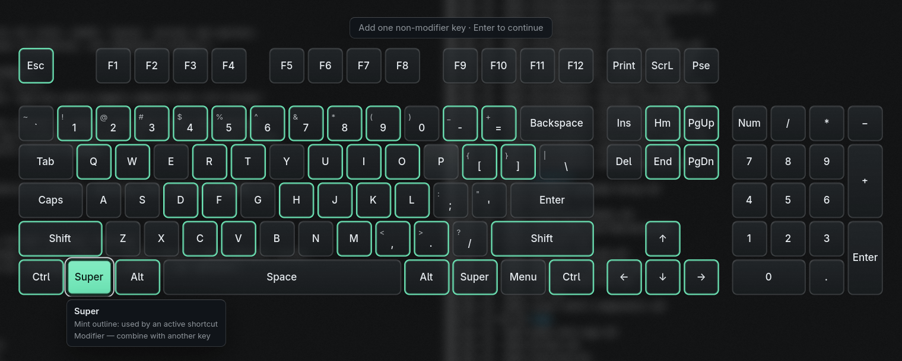

# Keymap

Keymap shows your Niri keyboard shortcuts on an on-screen keyboard and lets
you add, change and remove them without editing the config by hand.

Keymap works only with the [Niri](https://github.com/niri-wm/niri) Wayland
compositor. It reads and edits Niri's own configuration file.



## Features

- Shows which keys take part in a shortcut, and what each combination does,
  using your real Niri configuration, including every `include`.
- Binds a combination to any action: one already in your config, a Niri
  built-in, a program, a shell command or a Niri action with parameters.
- Removes shortcuts, and explains overridden or unreachable ones with their
  file and line.
- Checks every change with `niri validate` before writing it, backs up the
  previous files and offers Undo. Comments and formatting are kept.
- Opens over your windows with a blurred background, and stays loaded in the
  background so it opens quickly.
- Needs no root access, background service or network connection.

## Requirements

**Tested distributions.** Keymap was installed with the steps below on clean
virtual machines with Niri's default configuration:

| Distribution | Niri | Result |
| --- | --- | --- |
| Arch Linux | 26.04 | Installed and tested |
| Fedora 44 | 26.04 | Installed and tested |

Artix Linux uses the same packages and instructions as Arch, but was not part
of these tests. Other distributions have not been tested. Keymap may work on
any of them that provide the versions below.

**Runtime dependencies**

- Niri 26.04 or newer. Older versions start, but have no background blur.
- GTK 4.14 or newer, gtk4-layer-shell 1.0 or newer, and libxkbcommon.
- Optional: libpulse for sound (`libpulse` on Arch, `pulseaudio-libs` on
  Fedora). PipeWire desktops normally have it already. Without it, Keymap is
  silent.

**Build dependencies**

- Rust 1.88 or newer with Cargo, a C compiler and `pkg-config`.
- Development files for GTK 4, gtk4-layer-shell and libxkbcommon. On Arch the
  normal packages include them.
- Git, to download the source.

## Installation

Keymap is built from source and installed into your home directory
(`~/.local`). There are no release packages yet.

**What the installer changes.** `scripts/install.sh` installs three files:
`~/.local/bin/keymap`, `~/.local/bin/keymap-ui` and a desktop entry. It then
turns on background blur, which adds two things to your Niri config if they
are not already there:

- a layer rule that blurs only behind Keymap;
- a `blur` section with Keymap's "Light" strength, only if your config has no
  `blur` section.

Each change is checked with `niri validate` and backed up first. To leave your
Niri config untouched, run `KEYMAP_NO_BLUR=1 scripts/install.sh` instead.

The installer does not add a shortcut or a startup entry. You add those
yourself in the next steps. Running the installer again is safe. It replaces
the installed files and adds nothing twice.

### Arch Linux and Artix Linux

Install the dependencies (administrator):

```sh
sudo pacman -S --needed git rust pkgconf gtk4 gtk4-layer-shell libxkbcommon
```

Download and install Keymap (as your normal user, not root):

```sh
git clone https://github.com/resirect/keymap.git
cd keymap
scripts/install.sh
```

### Fedora

Install the dependencies (administrator):

```sh
sudo dnf install git rust cargo pkgconf-pkg-config gtk4-devel gtk4-layer-shell-devel libxkbcommon-devel
```

Download and install Keymap (as your normal user, not root):

```sh
git clone https://github.com/resirect/keymap.git
cd keymap
scripts/install.sh
```

### Check the installation

```sh
~/.local/bin/keymap check
```

This changes nothing. It prints the Niri config that Keymap found, the number
of shortcuts, the blur status, and whether the default shortcut is free.
`Editable: yes` at the end means Keymap can edit your config.

The commands here use the full path `~/.local/bin/keymap` because some
distributions (Arch and Artix, for example) do not put `~/.local/bin` on your
`PATH`. To type just `keymap`, add that directory to your `PATH` and log in
again:

```sh
echo 'export PATH="$HOME/.local/bin:$PATH"' >> ~/.bash_profile
```

### Add the shortcut that opens Keymap

```sh
~/.local/bin/keymap shortcut set
```

This adds one shortcut to your Niri config: **Super+Shift+M** opens and hides
Keymap. Niri applies it immediately.

Keymap never replaces a shortcut you already have. If Super+Shift+M is taken,
the command shows what uses it and changes nothing. Choose another
combination; `keymap check` suggests a free one:

```sh
~/.local/bin/keymap shortcut set Mod+Alt+K
```

## Quick start

1. Press **Super+Shift+M** (or the shortcut you chose). Keymap opens over your
   windows. Keys with a mint outline take part in a shortcut.
2. Click keys on the on-screen keyboard to select a combination, for example
   Super, then Shift, then S. Click a key again to deselect it.
3. Press **Enter** on your physical keyboard to open the action list. The
   top of the list shows what the combination does now.
4. Type to search, then select an action. **New action** (or Ctrl+N) creates
   a program, shell command or Niri action instead.
5. Select **Save**. If the combination or the action already has a shortcut,
   Keymap asks first. Cancel writes nothing.

After saving, Undo appears in the message and stays available in Settings →
Recent changes.

**Keys.** Only your physical keys navigate. The on-screen Tab, Enter and Esc
are ordinary keys that you can select.

| Key | On the keyboard view | Elsewhere |
| --- | --- | --- |
| Super+Shift+M | Hide Keymap | Hide Keymap |
| Enter | Open the action list | Activate the focused item |
| Tab | Open Settings | Move focus (Shift+Tab moves back) |
| Esc | Hide Keymap | Go back one step, or close the dialog |
| Arrows, Space | Move between keys, select the focused key | |

## Settings and startup

Press **Tab** on the keyboard view to open Settings. Settings are saved in
`~/.config/keymap/settings.json`.

**Start with your session.** To have Keymap load hidden when Niri starts, so
the first open is instant:

```sh
~/.local/bin/keymap autostart enable
```

This adds one `spawn-at-startup` line to your Niri config. It never shows
Keymap at login. `keymap autostart disable` removes that line and nothing
else.

**Fullscreen apps.** By default, the shortcut does nothing while a fullscreen
window has focus, such as a game or a video. If Keymap is already open, the
shortcut still hides it. To change this, turn on Settings → Opening → **Allow
opening over fullscreen apps**.

**Animation.** Settings → Keyboard → **Animations** turns off the ripple that
plays when the keyboard opens. **Reduce motion** shortens all movement.

**Sound.** Settings → Sound → **Sound effects** turns the quiet sounds on or
off, and **Volume** sets their level.

**Background.** Settings → Background turns blur on or off, sets its strength
and sets the dimming used without blur. Blur strength is a global Niri
setting, so it also affects anything else that uses blur.

## Updating and uninstalling

**Update** from the folder you cloned:

```sh
cd keymap
git pull
scripts/install.sh
```

The installer stops a running Keymap. The next shortcut press starts the new
version. Your settings, custom actions, backups and Niri config entries stay
as they are. Nothing is added twice.

**Uninstall** from the same folder:

```sh
scripts/uninstall.sh
```

This stops Keymap and removes the installed files. It also removes Keymap's
startup line and the shortcut that opens Keymap from your Niri config, with
the same checks and backups as any edit.

These stay in place:

- Shortcuts you created with Keymap, because they are part of your Niri
  setup.
- The blur layer rule and the `// Keymap: blur strength` section. Remove them
  by hand if you no longer want them.
- Keymap's settings, custom actions and backups. To remove those too, run
  `scripts/uninstall.sh --purge`.

## Troubleshooting

**`keymap: command not found`.** `~/.local/bin` is not on your `PATH`. Use
`~/.local/bin/keymap`, or add it to your `PATH` as described in
[Check the installation](#check-the-installation).

**`shortcut set` refuses.** The combination already does something else.
Pass another one, such as `~/.local/bin/keymap shortcut set Mod+Alt+K`.

**The shortcut does nothing.** Run `~/.local/bin/keymap shortcut status` to
see what opens Keymap. If a fullscreen window has focus, see
[Fullscreen apps](#settings-and-startup).

**No blur.** Settings → Background says why. Blur needs Niri 26.04 or newer
and Keymap's layer rule. `~/.local/bin/keymap blur enable` adds the rule.

**Keymap opens read-only.** Your Niri config has an error, or the file is not
writable. Settings → Niri configuration shows the file and line. Run
`niri validate` to see Niri's own message.

**The first open takes about a second longer than expected.** GTK's Vulkan
renderer can be slow to fail on some drivers. Starting Keymap with
`GSK_RENDERER=gl` avoids that; see [docs/ADVANCED.md](docs/ADVANCED.md).

For more detail, run Keymap with `KEYMAP_DEBUG=1` from a terminal.

### Known limitations

- Niri only. Tested with Niri 26.04.
- Background blur uses Niri's non-xray blur, which Niri marks as experimental.
  It can briefly disappear during animations.
- Only ANSI keyboards are drawn (60%, 75% and 100%). Shortcuts for keys
  missing from the drawing still appear in the action list.
- Mouse, scroll and touchpad shortcuts are shown and preserved, but cannot be
  edited.
- Shortcut options such as `repeat` and `cooldown-ms` are preserved, but
  cannot be edited.
- Multiple monitors have had only limited testing. Keymap opens on the monitor
  of the focused window.
- To open instantly, Keymap stays loaded while hidden and uses about 160 MB of
  memory. `keymap quit` frees it.

## More documentation

- [docs/ADVANCED.md](docs/ADVANCED.md): command reference, installing
  elsewhere, writing the shortcut by hand, blur details, how edits are made
  safe, and demo mode.
- [docs/ARCHITECTURE.md](docs/ARCHITECTURE.md): how the code is organized.

## Contributing and license

See [CONTRIBUTING.md](CONTRIBUTING.md) for building, testing and reporting
problems.

Keymap is dedicated to the public domain under
[CC0 1.0](LICENSE): anyone may use, modify and share it for any purpose,
without asking permission. The Rust libraries it builds on keep their own
licenses.
